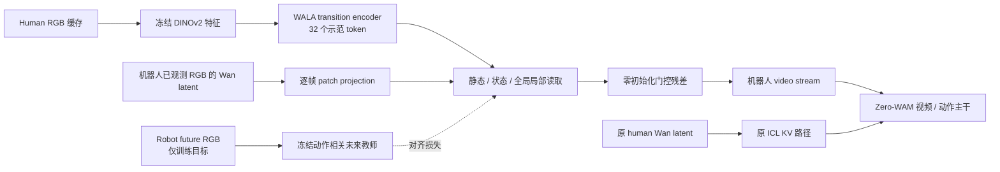

# RoboTwin subset12：四个示范读取实验

本组实验从 `RGB-Transition-ICL` 的 `2cea266` 分出，复用原 12 个训练任务、7 个未见评测任务、DINOv2 缓存、WALA tokenizer 和视频／动作／MCP 目标。原分支继续作为 RGB 表征基线。

这里研究**同一示范如何被读取**。短训练与推理检查只验证实现、梯度、保存和部署链路，不证明未见任务成功率提高。

本分支默认实验：`state`。两个新启动脚本默认采用该实验，显式设置 `RGB_READOUT_VARIANT` 可覆盖。

## 分支与配置

四个分支共用同一实现，通过实验配置区分；同一套代码也可以显式设置 `RGB_READOUT_VARIANT` 切换。每个分支的默认实验以该分支启动脚本为准。

| 分支 | `RGB_READOUT_VARIANT` | B300 配置 | 差异 |
| --- | --- | --- | --- |
| `RGB-Readout-Static` | `static` | `robotwin_subset12_rgb_readout_static_b300` | 固定 learnable queries 读取示范；不使用当前机器人状态调制读取 |
| `RGB-Readout-State` | `state` | `robotwin_subset12_rgb_readout_state_b300` | queries 结合机器人当前可用观测，读取当前相关的示范信息 |
| `RGB-Readout-GlobalLocal` | `global_local` | `robotwin_subset12_rgb_readout_global_local_b300` | 将默认 32-token human RGB memory 聚合为 16 个输出 token：4 个不受当前状态调制、12 个采用状态条件化读取 |
| `RGB-Readout-FutureTeacher` | `teacher` | `robotwin_subset12_rgb_readout_teacher_b300` | 使用 `state` 结构，增加与冻结动作相关未来教师的对齐目标 |

四卡配置把上表配置名末尾的 `_b300` 换成 `_train`。静态／状态默认 32-token 输出，教师版也使用状态版的 32-token 学生结构；全局＋局部默认 16-token 输出。后三者直接比较时，需要区分读取方式、输出预算和独立教师训练成本。在相同 token 预算下三种读取模式实例化相同参数结构；静态版仅关闭状态依赖。

**压缩仅发生在新增读取输出，原 human Wan 上下文保留。** 默认 human RGB memory 是 8 clips × 4 WALA tokens = 32，`global_local` 将其聚合为 16 个读取 token；原 memory 与 human Wan latent 不被删除。这不是完整 human 上下文替换，不能据此宣称 Zero-WAM 整体上下文压缩至 16 个 token 或推理已经加速。

默认 `global_local=16` 与 `state=32` 同时改变读取方式和 token 预算。纯读取方式对比必须显式匹配预算；两个变量同时作用于 B300 和四卡配置，启动前会拒绝非法分配：

```bash
# 与默认 static/state 的 32-token 预算比较读取方式。
RGB_READOUT_VARIANT=global_local ZERO_WAM_READOUT_TOKENS=32 \
  ZERO_WAM_READOUT_GLOBAL_TOKENS=8 bash script/train_rgb_readout_b300.sh --check-config

# 与默认 global_local 的 16-token 预算比较读取方式；static 同理。
RGB_READOUT_VARIANT=state ZERO_WAM_READOUT_TOKENS=16 \
  ZERO_WAM_READOUT_GLOBAL_TOKENS=4 bash script/train_rgb_readout_b300.sh --check-config
```

两组共同预算对照可以分开判断“如何读取”与“是否可用更少 token”。教师 artifact 的 token 数也必须匹配学生；当前教师阶段默认训练 32-token 目标。未来若做 16-token 教师对照，需独立训练 `--num-tokens 16` 的教师，同时设置学生 `ZERO_WAM_READOUT_TOKENS=16`、`ZERO_WAM_READOUT_GLOBAL_TOKENS=4`；预检会拒绝不匹配的教师。`global_local` 本身不需要教师。

## 来源与新增实现

| 部分 | 来源与边界 |
| --- | --- |
| 冻结 RGB encoder、预处理、缓存 | 沿用 [RGB 分支说明](README.rgb-transition.md) 中固定 revision 的 DINOv2-base；human 与 robot 使用同一特征空间 |
| Transition tokenizer / decoder | 沿用原样 vendored 的 [WALA 源码](https://github.com/liujiahao2077/WALA/blob/4a944f07afe09e24743f20d3d9ab809db672dc63/wala/model/modules/latent_action_model/latent_action_model.py)，许可证与 SHA256 见原分支说明 |
| 读取模块的 attention / FFN | 来自 [OpenFlamingo 的 Perceiver building blocks](https://github.com/mlfoundations/open_flamingo/blob/655f693fbfa04cd6e9a987d960654624d48917cf/open_flamingo/src/helpers.py)，保留计算与初始化，仅替换等价的 tensor rearrange 依赖；具体修改、SHA256 与 MIT 许可证见 [NOTICE](wan_va/modules/third_party/open_flamingo/NOTICE.md) |
| 任务相关选择与聚合的设计依据 | [AAAI SemanticVLA 论文](https://arxiv.org/html/2511.10518v1)、[公开 sampler](https://github.com/iLearn-Lab/AAAI26-SemanticVLA/blob/55a6be2698757fa66789ea9fab79e440f91e85a2/prismatic/models/mm_sampler.py)；本实验把该问题扩展到 human 示范与机器人状态，不等于复现其 SigLIP/DINO 双骨干内的剪枝与融合 |
| 动作相关未来目标与教师 query encoder | [WoG 的两阶段方法](https://arxiv.org/html/2602.22010v1#S3)、[QFormer 源码](https://github.com/Selen-Suyue/WoG/blob/872d1df6055c0dc5d2504d4d6a5fb71c2bae3e6c/vla/qformer.py)；保留 learnable queries、BERT cross-attention 和输出投影，缩小输出宽度与无用 vocabulary、去除 VAE/pooler 并加入 RGB 时空位置；动作 flow head 是本项目新增，不移植其完整 VLM 策略 |
| 本分支新增 | 示范读取模块、机器人侧接入、因果状态选择、训练／推理缓存处理、教师阶段、配置和检查；这些是需验证的新集成，不是上述论文已经证明有效的完整实现 |

全流程使用 RGB，不需要 depth。静态与状态版本只改变读取方式，保留已有三个 RGB 辅助目标：human 自重建、robot 自重建、human→robot 预测；权重与原 RGB 分支一致。

## 训练与推理的可见信息



与原 `RGB-Transition-ICL` 的融合位置不同：新配置不把 RGB 残差写进 human Wan token，而是在机器人视频的 noisy/clean stream 上使用同一个因果 readout。原 human Wan KV 路径完整保留。`static` 是这个新接入位置的对照；比较 `state` 与它才能隔离状态条件化的作用。状态来自当前真实观测的 Wan patch embedding，不需要在每次动作预测时额外运行 DINOv2。

Human 是完整示范，可以在执行前编码并缓存。读取结果若依赖机器人当前状态，应随执行窗口更新；不能只在加载 human 示范时计算一次后永久缓存。

状态查询只能使用机器人当前可用观测。训练中的 robot future RGB 可用于原辅助目标与教师目标，不能进入学生的状态查询或部署缓存。CFG negative、无示范、切换示范、reset 和替换真实观测均需要分别检查。

“全局”token 在这里指**状态不变的示范读取**，不是带有人工目标／事件标签的语义槽。默认 4/12 分配、教师对齐系数 `0.1` 是明确的初始研究设定，尚未按最终任务成功率选优。

## B300 单卡配方

沿用你的 subset12 单卡 baseline 配方：

| 项目 | 值 |
| --- | --- |
| GPU / microbatch / 梯度累积 | 1 / 1 / 8，全局 batch 8 |
| 训练步数 | 15,000 个梯度累积窗口 |
| 学习率 / warmup | `1e-4` / 200 步 |
| AdamW | betas `0.9, 0.95`，weight decay `0.01` |
| 精度 | BF16 计算，FP32 主参数与归约 |
| MCP / activation checkpointing | 保留基线设置 |
| CPU / activation offload | 关闭 |
| dataloader workers | 4 |
| checkpoint | 每 5,000 步保存 weights-only；不包含完整 optimizer/RNG 断点恢复 |
| W&B | B300 默认关闭；可显式 `--enable-wandb`，project `zero-wam` |

四卡测试配方为每卡 batch 1、累积 2，全局 batch 仍为 8。它验证本机 A800 上的真实训练链路，不代替目标 B300 的硬件兼容性和显存验证。

在目标服务器设置实际路径；已有 RGB 缓存可以迁移复用：

正式对照从同一份原始 `zero-wam-pretrain` 初始化。当前加载器会拒绝直接给一个已经训练过的 `RGB-Transition-ICL` checkpoint 补缺失 readout 参数，也会拒绝不同 token 预算的 checkpoint；不要把正在训练的旧 RGB checkpoint 直接替换为此处的 `MODEL_PATH`。

```bash
cd /path/to/Zero-WAM
export PYTHON_BIN=/path/to/baseline-env/bin/python
export MODEL_PATH=/path/to/zero-wam-pretrain
export HUMAN_GEN_ROOT=/path/to/HumanGen
export ZERO_WAM_RGB_FEATURE_ROOT=/path/to/rgb_transition_dinov2_base
export ZERO_WAM_SAVE_ROOT=/path/to/new-experiment-run
export RGB_READOUT_VARIANT=state
export CUDA_VISIBLE_DEVICES=0

# CPU 全数据检查，不加载大模型。
bash script/train_rgb_readout_b300.sh --check-config
```

切换实验使用 `static`、`state`、`global_local`、`teacher`，输出目录也应分别设置。沿用已有固定 human 示范映射和 7 个评测 human RGB 缓存，不能将未见任务的 robot future 混入教师训练。

## 有界训练检查

B300 上先跑两步，保留累积 8；显式样本白名单来自已准备的 12 任务短测报告：

```bash
SAMPLE_IDS=$("$PYTHON_BIN" -c 'import json,sys; r=json.load(open(sys.argv[1])); assert r["smoke_subset"] and r["pairs"] == r["tasks"] == 12; print(",".join(r["sample_ids"]))' "$ZERO_WAM_RGB_FEATURE_ROOT/smoke_report.json")
export ZERO_WAM_SAVE_ROOT=/path/to/new-b300-smoke-run
bash script/train_rgb_readout_b300.sh \
  --smoke-test --rgb-smoke-sample-ids "$SAMPLE_IDS" \
  --num-steps 2 --save-interval 2 --load-worker 0 --disable-wandb
```

本机四卡入口默认每任务一个真实配对、6 步，拒绝 `RGB_SMOKE_STEPS` 超过 20：

```bash
export RGB_READOUT_VARIANT=state
export ZERO_WAM_SAVE_ROOT=/workspace/zero-wam/runs/readout-state-smoke
export ZERO_WAM_METRICS_PATH=/share/personal/xiangzishang/logs/readout-state-smoke.jsonl
CUDA_VISIBLE_DEVICES=0,1,2,3 bash script/smoke_rgb_readout.sh
```

保存后使用真实三相机输入检查服务推理。将 `INFERENCE_MODEL_ROOT/transformer` 指向短测保存的 transformer，其余 `vae/tokenizer/text_encoder` 复用原模型：

若 `/workspace` 挂载不支持符号链接，可把只包含链接的 bundle 目录建在 `/share/personal/xiangzishang` 下；权重文件仍保存在 `/workspace`，无需复制一份大模型。

```bash
CUDA_VISIBLE_DEVICES=0 "$PYTHON_BIN" tools/smoke_rgb_inference.py \
  --model-path "$INFERENCE_MODEL_ROOT" \
  --data-config "robotwin_subset12_rgb_readout_${RGB_READOUT_VARIANT}_b300" \
  --second-chunk --output-json /path/to/inference-check.json
```

这个入口沿用官方 `50/50` 采样步数，检查动作、缓存、切换示范与 CFG 隔离。readout checkpoint 还会在 probe 前编码真实初始观测，并仅干预新增读取模块的状态输入：静态输出应不变，状态输出应变化，全局＋局部版的 global token 应不变、local token 应变化。分界从保存的模型配置读取，支持默认 4/12 和预算对照 8/24。报告记录实际 readout 调用和观测更新；这些是机制检查，不是任务能力证据。它不执行 RoboTwin 闭环，不产生任务成功率。

## 未来教师的独立阶段

教师通过训练任务中的真实 robot future RGB 学习紧凑条件，并由动作目标训练；学生只接收从 human 示范与当前机器人观测得到的读取结果。教师不接收真实动作作为编码输入；动作只参与其训练目标。后训练时教师冻结，部署时不需要教师与 robot future。

先做教师短测：

```bash
"$PYTHON_BIN" tools/train_rgb_future_teacher.py \
  --human-gen-root "$HUMAN_GEN_ROOT" \
  --feature-root "$ZERO_WAM_RGB_FEATURE_ROOT" \
  --output /workspace/zero-wam/runs/readout-teacher-smoke/teacher \
  --device cuda:0 --gradient-accumulation-steps 8 \
  --smoke-test --num-steps 6 \
  --smoke-report "$ZERO_WAM_RGB_FEATURE_ROOT/smoke_report.json"

export RGB_READOUT_VARIANT=teacher
export ZERO_WAM_FUTURE_TEACHER=/workspace/zero-wam/runs/readout-teacher-smoke/teacher
export ZERO_WAM_SAVE_ROOT=/workspace/zero-wam/runs/readout-teacher-policy-smoke
bash script/smoke_rgb_readout.sh
```

教师 artifact 包含 `teacher.safetensors`、`metadata.json` 和 `COMPLETE.json`，记录特征来源、配置、训练状态与校验信息。标记为 smoke-only 的教师只能用于有界 policy 短测，不能作为正式实验教师。教师短测通过只说明链路可训练，并不说明它已经提供高质量目标。

正式教师训练先采用独立的 2,000-step 初始研究预算，梯度累积 8；这个预算不是 WoG 论文配方或已验证最优值。完成教师有用性／可预测性验证后再投入正式学生训练。教师训练耗时和额外前向需要计入实验总成本。

```bash
# 后续正式教师实验命令，不属于本次有界检查。
"$PYTHON_BIN" tools/train_rgb_future_teacher.py \
  --human-gen-root "$HUMAN_GEN_ROOT" \
  --feature-root "$ZERO_WAM_RGB_FEATURE_ROOT" \
  --output /workspace/zero-wam/runs/readout-teacher-formal/teacher \
  --device cuda:0 --gradient-accumulation-steps 8 --num-steps 2000

# 正式 policy 的第二阶段必须显式切换到上述正式教师。
export RGB_READOUT_VARIANT=teacher
export ZERO_WAM_FUTURE_TEACHER=/workspace/zero-wam/runs/readout-teacher-formal/teacher
export ZERO_WAM_SAVE_ROOT=/workspace/zero-wam/runs/readout-teacher-policy-formal
bash script/train_rgb_readout_b300.sh --check-config
```

## 正式学生训练与实验边界

确认完整数据预检、目标硬件短测、保存重载和推理检查均通过后，正式入口为：

```bash
# 后续正式训练命令；本次测试不执行这条长训练。
export ZERO_WAM_SAVE_ROOT=/path/to/new-formal-run
export WANDB_PROJECT=zero-wam
export WANDB_NAME=rgb-readout-state-b300
bash script/train_rgb_readout_b300.sh --enable-wandb
```

教师版本还需指向正式训练的 `ZERO_WAM_FUTURE_TEACHER`。其余版本忽略该变量，不加载教师。学生保存仍是 weights-only，不能将它解释为完整断点恢复。

比较时固定初始化、12/7 划分、数据、采样、优化器和评测配置。读取方式实验固定相同 token 预算；压缩实验明确改变预算，并计入参数量与实际速度、显存。开发集需要预先按 robot episode 与 human 源视频分组；当前模型见过的训练样本不能事后成为独立验证集。七个未见任务不用于反复选超参数。

状态读取机制的重要对照是只给新读取模块过时／错位观测，主 Zero-WAM 保持正确观测。成功率、示范替换、必要操作顺序和实际分支干预，比 attention 图或单个辅助 loss 更能判断 ICL 是否改善。

## 验证记录

2026-11-07 在本机 A800 环境执行 `HUMAN_GEN_ROOT=/workspace/zero-wam/datasets/HumanGen python -m pytest -q tests`：**362 passed**。仓库的 `evaluation/robotwin/test_render.py` 是需要另一套 SAPIEN 环境的渲染入口，不属于上述 `tests/` 回归结果；本次不声称已做 RoboTwin 闭环成功率评测。

B300 配方的 CPU 全数据预检通过：12 个训练任务、600 对 human/robot 数据、全局 batch 8。目标 B300 的 GPU 短测仍需在目标机器执行，本机四卡 A800 结果不能代替该项。

四种策略均在 **4×A800 80GB、每卡 batch 1、累积 2** 下完成 6 个优化窗口，选用 12 个任务各自最长的配对样本（最长 35 个 latent anchors）。所有 loss/梯度有限，零跳步，门控从零更新，8 个权重分片均通过写入后 SHA256 校验。末步结果如下，仅用于核验链路；训练仍处于 200-step warmup 内，不能作方法效果比较。

| 方案 | 视频 loss | 动作 loss | 加权 RGB loss | 加权教师 loss |
| --- | ---: | ---: | ---: | ---: |
| static32 | 0.240240 | 0.011478 | 0.223678 | 0 |
| state32 | 0.240251 | 0.011461 | 0.223678 | 0 |
| global_local16 | 0.240249 | 0.011437 | 0.224714 | 0 |
| teacher32 | 0.240236 | 0.011438 | 0.223736 | 0.100408 |

策略 checkpoint 位于 `/workspace/zero-wam/runs/rgb-readout-{static,state,global_local,teacher}-smoke-20261107/checkpoints/checkpoint_step_6`。日志和 JSON 证据位于 `/share/personal/xiangzishang/logs/rgb-readout-20261107`。

独立教师短测为 2 个优化步、累积 8，覆盖全部 12 个样本；动作 flow loss 为 1.644527、1.360290，未来 encoder 梯度非零且有限，保存后重载目标逐值一致。该 artifact 明确标为 **smoke-only**，正式策略预检会拒绝它；正式实验须先完成独立教师训练和有用性验证。

四份策略 checkpoint 的真实服务推理均通过：单卡 A800，视频／动作各 50 步，ICL CFG=5，两段动作输出均为 `[16, 2, 16]` 且有限。严格加载报告的 missing/unexpected/mismatched/error 列表均为空；切换示范、无示范、真实观测缓存更新及 CFG 隔离检查通过。每次完整测试记录 106 次 readout 调用，部署未读取 robot future 或冻结教师。

仅改变 readout 状态的干预结果：static 输出严格不变；state/teacher 输出 token 改变；global_local 的前 4 个 token 严格不变、后 12 个改变，四者的 CFG 负分支变化均为零。**state 的 6-step checkpoint 虽然 readout token 已响应状态，BF16 策略 probe 输出仍未改变**（门控仅约 `3.85e-7`）；这不能作为已学会状态控制的证据。教师和压缩版本该 probe 的正分支发生变化，也不代表成功率改善。原始诊断保存在各 `*-inference.json`，供后续在有效训练步数后重复比较。

| 默认方案 | RGB 模块唯一参数量 | 其中新增 readout 参数量 |
| --- | ---: | ---: |
| static / state / teacher 学生，32 tokens | 9,643,265 | 2,377,472 |
| global_local，16 tokens | 9,639,169 | 2,373,376 |

在真实 `from_pretrained` 路径中，同一预算、同一 seed 的 static/state/global_local 学生参数初值逐值一致；teacher 使用相同 state 学生结构。所有实验加载同一份原始 Zero-WAM 主干。**32→16 会改变构造过程的随机数消耗，因此跨预算时旧 RGB 辅助模块的初值也不保证逐值一致。** 比较读取机制使用同预算对照；比较压缩预算应重复多个 seed，不能把一次跨预算结果全部归因于压缩。参数量见 `readout-parameters.json`；实际加载路径的初始化核验见 `readout-pretrained-initialization-audit.json`，前者直接构造器的初始化结果不能替代后者。

实际短训练 loss、保存目录、重载和推理结果以本次日志／JSON 报告为准。短测试验证实现，不代表已获得有效任务策略，也不据此估算正式 B300 长训练耗时。
